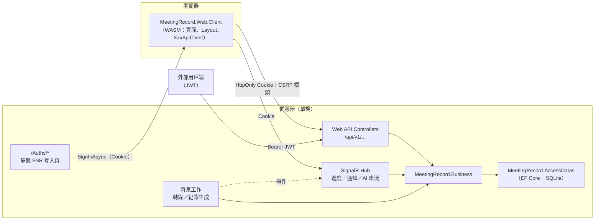

# Blazor Server → Blazor WebAssembly 遷移評估與測試策略

- 文件版本：1.40
- 文件狀態：已啟動遷移（M0～M4 完成並合回 main，M5 進行中，IIS 測試機驗證待補）
- 現行系統版本：1.1.35
- 首次實作版本：不適用
- 最後核對日期：2026/11/11

使用者要求：

> 現在這個專案採用 Blazor Server side interactive，我想要將這個專案改成 Blazor Wasm 架構……需要請你評估這樣的想法是否做得到，若有困難或者不可以，也請說明問題在哪裡，或者有甚麼建議。若是可行，我要如何知道改成 wasm 之後，這個系統同樣會正常運作……可以的話，產生一份測試報告。

已與使用者確認的前提（決策紀錄見第十節）：

- **動機**：連線斷線／延遲、伺服器負載與擴充性、前後端分離（API 化）；系統將**對外服務**，人數可能更多。
- **範圍**：**純 WASM**——所有互動頁面都在瀏覽器執行，伺服器只剩 Web API、SignalR Hub、靜態 SSR 的登入頁與 WASM 靜態檔。
- **擴充性**：這次只做 WASM、**維持單機**；多機的限制列為後續議題（第四節 4.14）。
- **驗證方式**：同網域 Cookie（BFF），沿用現有登入 Cookie；JWT 留給外部用戶端。
- **策略**：**開一個分支一次改完**；遷移期間 main **凍結新功能、只修 bug**，每筆修正同步合進分支。
- **測試報告**：要等遷移完成才能比對兩版，本文件先定好**測試策略、完成門檻與報告格式**（第八、九節）；第一步（M0）是在 main 上先建立現行 Server 版的基準測試。

---

## 一、結論摘要

**做得到，沒有技術上的死路**：AntDesign 1.6.0 支援 WebAssembly，`Share`／`Models`／`Dtos` 三個專案可以直接給瀏覽器端共用，FFmpeg、PDF、Azure OpenAI、SQLite 這些只能在伺服器做的事，本來就可以留在伺服器、包成 API。

**但這不是「加一些 Web API」的規模**，實質上是三件事同時做：

1. **重寫 UI 的資料存取層**：現在 22 個頁面的元件都是**直接注入 Business 服務**在伺服器上呼叫，沒有經過 HTTP。改成 WASM 後，每一個呼叫都要變成「瀏覽器 → HTTP／SignalR → API → Business 服務」。
2. **補齊整套 API**：現有 37 支端點只涵蓋 6 個實體的基本 CRUD 與登入；28 頁中約 20 頁**完全沒有 API**。依服務方法盤點，預估要**新增約 120～170 支端點**，外加 1 個 SignalR Hub。
3. **把安全邊界整個搬到 API**：現在畫面上的 `CheckAccessAction`／`CheckAccessPage` 跑在伺服器，可以信任；改成 WASM 後它們**只決定按鈕要不要顯示**，任何人都能繞過畫面直接打 API。所有授權與資料可見範圍都必須在 API 端重新把關一次——**這是本次遷移最大的風險**。

改完能得到的：

| 動機 | WASM 能不能解決 |
|---|---|
| 連線斷線、遠端延遲、提示框卡住 | ✅ 互動在瀏覽器本機執行，不再有 circuit；斷網只影響正在呼叫的 API |
| 每個使用者佔一條 circuit 的伺服器記憶體 | ✅ 伺服器只處理無狀態的 API 請求 |
| 前後端分離、未來接行動 App／其他用戶端 | ✅ API 成為唯一後端，同一批 Controller 同時服務 WASM 與外部用戶端 |
| 多台伺服器水平擴充 | ❌ **不能**：擋住多機的是 SQLite 單一檔案、記憶體內的工作佇列與推播、本機檔案儲存，跟 WASM 無關（4.14） |

另外會順帶解決一個現存問題：大檔上傳現在走 SignalR 串流，IIS 上 127 MB 的 mp4 約 11 秒就斷線並拖垮整條 circuit（[會議上傳進度與連線中斷](../changelog/2026-10-08-會議上傳進度與連線中斷.md) §4）。改成分塊 HTTP 上傳後，這個問題自然消失。

---

## 二、現況盤點

| 項目 | 現況 | 位置 |
|---|---|---|
| Render mode | 依路徑決定：`/Auths/*` 靜態 SSR，其餘 `InteractiveServer(prerender: false)`；沒有 `.Client` 專案 | `MeetingRecord.Web/Components/App.razor.cs` |
| SignalR 設定 | `MaximumReceiveMessageSize = 10 MB`（為長文字框調高，不是為上傳） | `MeetingRecord.Web/Program.cs` |
| UI 規模 | 74 個 `.razor`、28 個路由頁（22 個實際頁面，其餘為樣板殘留），razor／razor.cs 約 23.5k 行 | `MeetingRecord.Web/Components/` |
| 最大的 code-behind | ProjectViewView 1,864 行、MeetingViewView 1,645、TodoViewView 1,058、AiChatModal 1,044、ExceptionLogView 854 | `Components/Views/**` |
| 元件取資料的方式 | 直接注入 Business／Web 服務（建構式注入、`[Inject]`、`@inject`），約 50 個元件注入伺服器端服務 | — |
| UI 會呼叫的服務 | 29 支服務類別，公開方法合計約 212 個 | `Business/Services/**`、`Web/Diagnostics/*`、`Web/Health/*` |
| 既有 Web API | 37 支端點：Auth 3、Google 登入 2、Category／Meeting／Project／PromptTemplate／Team／Todo 各 5（GET、search、POST、PUT、DELETE）、樣板 WeatherForecast 1；只收 JWT | `MeetingRecord.Web/Controllers/` |
| 即時推播 | 3 個 singleton C# event：轉錄進度、會議紀錄生成進度、通知鈴；另有 singleton 取消登記 | `Business/Services/{Transcription,TextGeneration,Notifications}`、`Other/JobCancellationRegistry.cs` |
| AI 串流 | 4 處 `onDelta` 逐段更新畫面：AI 問答、使用說明 AI 助理、AI 日誌分析、AI 例外分析 | `AiChatModal`、`HelpView`、`LogViewerView`、`ExceptionLogView` |
| 上傳 | 3 處 `InputFile` 經 SignalR 串流：會議影音（1 GB）、專案附件（1 GB）、AI 問答附件 | `MeetingViewView`、`ProjectViewView`、`AiChatModal` |
| 下載 | 8 個頁面經 `DotNetStreamReference` → `download.js`；**刻意不開下載端點**（API 只收 JWT，`<a href>` 帶 Cookie 會 401） | `Web/Services/FileDownloadInterop.cs` |
| PDF | 7 處，伺服器以 headless Edge／Chrome 轉檔 | `Business/Services/Export/HeadlessBrowserPdfRenderer.cs` |
| 目前使用者 | `CurrentUserService`（scoped）由 `AuthenticationStateHelper.Check` 每頁填入；該 helper 在 **Business 層**且依賴 `AuthenticationStateProvider`、`NavigationManager` | `Business/Services/Other/AuthenticationStateHelper.cs` |
| DbContext | `AddDbContext` scoped＝**一條 circuit 共用一個**，因此全站有「不可並行」的慣例 | `ServiceCollectionExtensions.cs` |
| JS interop | 9 支 `wwwroot/js/*.js` ＋ `ReconnectModal.razor.js` | `MeetingRecord.Web/wwwroot/js/` |
| 測試 | xUnit 共 1,717 個測試案例（1,344 個 Fact＋103 個 Theory 展開；1.0.56 實跑全數通過），以服務層為主；API 整合測試只涵蓋 Auth／Project／Todo；約 22 個原始碼掃描測試；**沒有 bUnit、沒有 E2E** | `MeetingRecord.Tests/` |
| CI | push／PR：Release build → `dotnet test` → 文件編碼檢查 → 弱點套件掃描 | `.github/workflows/dotnet-ci.yml` |

**可以給 WASM 共用的專案**：`Share`、`Models`（AdapterModel）、`Dtos` 都是 `net10.0`、沒有套件相依。**不能**：`Business`（相依 EF Core、OpenXml、PdfPig…）、`AccessDatas`。

---

## 三、逐項可行性

難度：🟢 低（照既有模式即可）／🟡 中（要設計但有標準做法）／🔴 高（牽動安全或大量程式）

| 領域 | 現況 | WASM 作法 | 難度 |
|---|---|---|---|
| 登入／登出 | `/Auths/*` 靜態 SSR 表單＋`HttpContext.SignInAsync` | **原樣保留**：登入頁本來就不是互動頁，Cookie、記住我、TOTP、Google 登入、Data Protection 金鑰都不用動 | 🟢 |
| 使用者狀態與權限 | `AuthenticationStateHelper.Check` 每頁查 DB、填 `CurrentUserService` | 新增 Session 端點（`GET /api/v1/session`）回傳使用者、有效權限鍵、是否管理者、是否需改密碼；WASM 端自訂 `AuthenticationStateProvider`；伺服器端改成每次請求依 Cookie claims 解析目前使用者 | 🔴 |
| 動作授權 | UI `CheckAccessAction`（伺服器端執行，可信） | UI 照樣用它決定顯示，**但每支 API 都要 `[HasPermission]`**；只限管理者的頁面要有對應的管理者授權 | 🔴 |
| 資料可見範圍 | Blazor 服務層經 `ProjectAccessService` | 服務層規則不變；API 一律經同一套服務，看不到回 404 | 🟡 |
| 一般 CRUD 頁 | 直接呼叫 `XxxService` | `XxxApiClient`（typed `HttpClient`）＋ API；分類、團隊、提示詞已有部分 API 可擴充 | 🟡 |
| 專案／會議／待辦頁 | 三個最大的頁面，混合 CRUD、上傳、背景工作、AI | 逐功能拆 API；工作量最大 | 🔴 |
| 影音與附件上傳 | `InputFile` 經 SignalR，最大 1 GB | 分塊上傳端點（第四節 4.6） | 🟡 |
| 下載、PDF、CSV | `DotNetStreamReference` | Cookie 授權的 GET 端點，`<a href>` 或 `fetch` 下載 | 🟢 |
| 背景工作進度、取消 | singleton event → `InvokeAsync(StateHasChanged)` | SignalR Hub 推送，伺服器端依專案權限過濾後才送出 | 🟡 |
| 通知鈴 | singleton event | 同一個 Hub，以使用者群組推送 | 🟢 |
| AI 串流 | `onDelta` 逐段更新 | SignalR streaming（`IAsyncEnumerable`）或 HTTP 串流 | 🟡 |
| 管理與監控頁 | 直接讀日誌檔、DB 檔大小、磁碟、NLog 執行期設定 | 全部包成「只限管理者」API | 🟡 |
| 使用說明手冊 | 內嵌資源，依身分決定是否含管理員章節 | 由 API 回傳（管理員章節不能整份送到瀏覽器再藏） | 🟢 |
| 側邊選單 | `SidebarMenuService` 讀 `Menu.json`、依權限過濾 | 選單結構可隨 WASM 下發；權限過濾沿用 `FilterAuthorizedMenuItems` 純函式（搬到共用專案） | 🟢 |
| JS interop | 9 支 | 全部沿用；`ReconnectModal` 移除；`client-error-reporter` 改呼叫 API | 🟢 |
| 樣式 | AntDesign、scoped CSS、`app.css` | 不變（scoped CSS 在 WASM 照樣編譯） | 🟢 |
| 測試 | 服務層測試、原始碼掃描 | 服務層不變；新增 API 授權測試與 E2E 對照測試；掃描測試改路徑 | 🟡 |

---

## 四、問題點與風險（依嚴重度）

### 4.1 安全邊界移動 🔴（最大風險）

現在的安全模型建立在「UI 程式跑在伺服器」這個前提上。[開發慣例與限制速查](../architecture/開發慣例與限制速查.md) §5 明寫：**Blazor 服務層只管資料可見範圍、不檢查動作權限**，會寫入資料的按鈕都要包 `CheckAccessAction`。

改成 WASM 後這個前提消失：瀏覽器裡的程式碼與判斷都可以被修改或繞過，使用者可以用 DevTools 或 curl 直接呼叫任何 API。因此：

- **每支新 API 都要有 `[HasPermission("頁面:動作")]`**，對應原本畫面上的 `CheckAccessAction`；只限管理者的頁面（`AdminOnlyMenuIds` 那 8 頁）要有管理者授權。
- **看不到的一律回 404**，不要回 403（等於告訴對方資料存在）。
- 原本只在畫面上做的業務規則要逐條搬進服務層或 API：負責人才能刪（`ProjectAccess.IsProjectOwner`）、上傳者才能換檔／重轉錄（`IsMeetingOwner`）、封存專案唯讀（`ProjectArchiveRules`）、甲方只能刪自己建立的待辦、付費動作的二次確認（確認框留在畫面，但 API 不能因此省略額度檢查）。
- **新增一律 `Id = 0`**（既有慣例），避免用戶端指定編號探測別人的資料。
- 防護措施：L2 的**反射掃描測試**（每個 action 必須有授權屬性或在明列的白名單）、**依人物的授權矩陣測試**、L5 的 IDOR 實測（第八節）。

### 4.2 「目前使用者」的取得方式 🔴

- `CurrentUserService` 現在每條 circuit 填一次，Business 服務（`RecordAccessScopeProvider`、`AuditActorProvider`、`HelpAssistantService`、權限檢查…）直接讀它。改成每次 API 請求都要從 Cookie claims 解析並填入——`RecordAccessScopeProvider` 已經有從 `Sid` claim 建立範圍的路徑（`Web/Auth/RecordAccessScopeProvider.cs`），可以以它為基礎。
- ⚠️ **1.1.28 補記**：M3 搬頁時漏了 AI 呼叫者——`AiChatService`、`TodoExtractionService`、`MeetingService` 取帳本使用者只看 `CurrentUserService`，經 API 時是空的，每人額度擋不住。改經 `IAiCallerProvider`（API 從 claims 取）。後續把頁面搬到 WASM 時，服務裡任何讀 `CurrentUserService` 的地方都要檢查。
- `AuthenticationStateHelper` 放在 Business 層卻相依 Blazor 的 `AuthenticationStateProvider`／`NavigationManager`，這本來就不太對；遷移時把「導向」與「查使用者狀態」拆開：狀態判斷留在伺服器，導向交給 WASM。
- 帳號被停用、沒有角色、需要強制改密碼時，現在是 `NavigateTo(forceLoad)` 導走。改成 API 回應明確的狀態碼與原因（包在 `ApiResult`），WASM 端統一攔截處理；⚠️ 「未認證」仍只能導向 `/Auths/Login`，不可導向會呼叫 `SignOutAsync` 的頁面（§4 既有規則）。
- 權限有變動時：現在登入時載入一次；WASM 也一樣以 Session 端點載入，**但 API 每次請求都以伺服器端的權威來源判斷**，前端快取過期只會造成「按鈕多顯示一顆、按了回 403」，不會造成越權。

### 4.3 API 面積 🔴

- UI 會呼叫的 29 支服務共約 212 個公開方法，扣掉既有 CRUD 已涵蓋的部分與純內部用途，預估**新增 120～170 支端點**，另加 PDF／CSV 匯出（約 12 種）、下載、上傳、1 個 Hub。
- **M1 後重估（1.1.3，逐方法盤點 UI 實際呼叫的服務方法）**：共 **174** 個，既有 API 已涵蓋 **25** 個；其餘 149 個裡 **21** 個可以併進既有端點（新增／修改前的檢查、啟用切換、待辦完成），**約 128 個要新開**；另加匯出約 12 種、下載、上傳開始與完成。M1 已開 3 支（Session、選單、未讀數），Hub 已建。依里程碑分配：

  | 里程碑 | 區塊（UI 呼叫的方法數／既有已涵蓋／待開） | 待開 |
  |---|---|---|
  | M2 | 分類 10/4/6、團隊 13/4/9、提示詞 9/4/5、使用者 15/0/15、角色 10/0/10、儀表板 1/0/1 | 46 |
  | M3 | 會議 16/4/12、專案 14/4/10、待辦 14/4/10、通知與背景工作 10/0/10、共用（PDF、資料範圍）2/0/2、登入外框 3 | 47 |
  | M4 | AI 問答 9/0/9、說明頁 AI 1/0/1、待辦抽取 3/0/3 | 13 |
  | M5 | 監控與管理（稽核、AI 對話紀錄、Token 用量、例外、日誌、日誌等級、資料庫用量、健康監控）40/0/40 | 40 |
  | M1（已完成） | Session、選單、未讀數 | 3 |

  「待開」含可併入既有端點的 21 個；實際新開數以各里程碑拆法為準。M5 方法最多，但大多是查詢、匯出與清除，形狀單純。
- **M2 實際（1.1.14，從各 Controller 的 `[Http*]` 統計，與 1.1.3 比較）**：端點由 39 支增為 76 支，**新開 37 支**——帳號 4（使用者選單改密碼、變更密碼頁、密碼狀態、API 密碼）、通知 3、關於 1、頁面拒絕稽核 1、分類 2、團隊 3、提示詞 5、使用者 9、角色 8、儀表板 1；另外分類、團隊、提示詞既有的 15 支 CRUD 改走畫面用的同一套服務。比預估的 46 個方法少，是因為新增／修改前的檢查與同步團隊、成員都併進了新增與修改端點。
- **M3 實際（1.1.27，從各 Controller 的 `[Http*]` 統計）**：**新開 65 支**——背景工作 4（`api/v1/jobs`）、上傳工作階段 5（建立、查狀態、取消、回報失敗、專案附件）、待辦 7、會議 13、AI 問答 10（含 2 支串流）、專案 11、專案頁裡的會議 12、待辦抽取 3；另外待辦、會議、專案既有的 15 支 CRUD 改走畫面用的同一套服務，**最後一個 Repository 也刪了**。比 1.1.3 估的 M3 約 47＋M4 的 AI 問答與待辦抽取約 12 多出一些，主要是「同一個動作在會議頁與專案頁各依自己的權限開一份」（約 10 支）與上傳、下載、PDF。
- **M4 實際（1.1.31）**：**新開 2 支**（`GET api/v1/help/manual`、`POST api/v1/help/assistant/ask` 串流），與估計一致；另修正 M3 留下的 AI 呼叫者歸屬缺陷（1.1.28，不新增端點）。
- 原則：沿用 `ApiResult<T>`／`PagedResult<T>`、`/api/v1/...`；只開 UI 真的需要的方法，不要把服務一對一機械式外露。

### 4.4 即時推播 🟡

- 新增一個 Hub（例：`/hubs/app`），以 Cookie 驗證；連線時把使用者加進 `user:{id}` 群組。
- 由一個 hosted service 訂閱現有的三個 singleton notifier，**在伺服器端依 `ProjectAccessService` 過濾**後才推送給有權看的人（現在 `BackgroundJobProgressPanel` 是在元件裡過濾，搬到伺服器後不能把全公司的進度整包送到瀏覽器再濾）。
- 取消背景工作改成 Hub 方法或 API，仍需會議紀錄的 Edit 權限。
- 斷線重連：用 SignalR 自動重連，重連後重新取一次快照。
- **實作現況（1.1.2）**：`Web/Hubs/AppHub`（`/hubs/app`，policy scheme 驗證，群組 `user:{id}`）與 `HubNotificationBridge`（轉送 `IUserNotificationNotifier`）已上線，WASM 端 `Realtime/AppHubConnection` 自動重連、重連後重查；目前只推「通知有變動」給 WASM 版面的未讀數。兩個進度通知器（轉錄、會議紀錄生成）1.1.15 接上：`JobProgressHubBridge` 節流後推不帶資料的 `JobsChanged` 給所有連線，WASM 面板收到再打 `api/v1/jobs`，由伺服器依 `ProjectAccessService` 過濾（不把全公司的進度送到瀏覽器）；取消走 API，要會議紀錄的 Edit 權限。

### 4.5 AI 串流 🟡

- 用 SignalR streaming（Hub 方法回傳 `IAsyncEnumerable<string>`）或 HTTP 串流（WASM 端 `SetBrowserResponseStreamingEnabled(true)`）。建議統一用 Hub，取消語意比較好處理。
- `AiCallGateway` 的額度檢查、用量帳本、AI 對話紀錄**全部留在伺服器**，不變；`AiQuotaExceededException` 要對應成明確的錯誤回應。
- AI 問答目前沒有傳 `CancellationToken`（靠擋住關閉視窗），改成 WASM 後使用者可以直接關分頁，伺服器端要能感知連線中斷並取消，否則會繼續計費。

### 4.6 1 GB 上傳 🟡

> **1.0.60 已完成第一步**：檔案位元組改走 HTTP 分塊上傳（`UploadChunkController`＋`chunk-upload.js`），解掉 IIS 斷線問題；開始／完成／取消仍在 Blazor 連線內。WASM 遷移時再補開始與完成的端點。與下面原規劃的差異：沒有先暫存整個檔案再提交，而是把分塊直接接成串流交給既有服務層，見 [檔案上傳機制](../features/檔案上傳機制.md) §3.0.1。


- 分塊上傳端點（例：每塊 8 MB，`初始化 → 逐塊上傳 → 完成`），伺服器暫存後合併，再交給既有的 `MeetingService.SaveMediaAsync`／專案附件流程。
- 可以避開 IIS 預設 `maxAllowedContentLength`（約 30 MB）與請求逾時，單塊失敗只重送該塊。
- 上傳進度在瀏覽器端計算；「跨頁籤、跨電腦看得到上傳進度」（0.4.117）要改由伺服器依已收到的塊數經 Hub 廣播。
- 既有驗證（副檔名、大小、專案權限、上傳者規則、付費確認的位置）要在**初始化**時就檢查，不要等 1 GB 傳完才拒絕。

### 4.7 下載、PDF、CSV 🟢

- 改成 Cookie 授權的 GET 端點，回傳 `Content-Disposition: attachment`；每個端點套跟頁面一樣的權限與資料範圍，並寫稽核（現有 `Project.TodoExportPdf` 等動作代碼沿用）。
- 原本「不開下載端點」的理由是 API 只收 JWT；改成 Cookie BFF 後這個理由消失。

### 4.8 Cookie API 的 CSRF 防護 🟡

Cookie 會被瀏覽器自動帶上，所以會改資料的 API（POST／PUT／DELETE）要防跨站請求偽造：

- 登入 Cookie 維持 `SameSite=Lax` 或更嚴；
- 會改資料的請求必須帶自訂標頭（例：`X-Requested-With`）或 antiforgery token，伺服器驗證；
- CORS 不開放給其他網域帶 Cookie。

驗證方式用 policy scheme：請求帶 `Authorization: Bearer` 就走 JWT（外部用戶端），否則走 Cookie（WASM）。同一批 Controller 兩邊共用，CSRF 檢查只套在 Cookie 路徑。

### 4.9 DbContext 從「每條連線」變成「每次請求」 🟡

- 好處：§3 的「同一個 context 不能並行」限制基本上消失，`BatchRunner` 依序執行、`isLoading` 早退之類的保護可以重新檢討。
- 要注意：
  - 「寫入失敗一定要清追蹤」的問題在每請求模式下自然消失，但服務層的寫法仍保留，不必回頭拆。
  - `Clone()` 的用途改變：WASM 端拿到的本來就是反序列化出來的副本，不會污染伺服器資料，但**取消編輯時要還原畫面**的需求還在。
  - **§6.2 六支服務的分頁 bug 會浮出來**：`Category`／`Meeting`／`MyUser`／`Project`／`RoleView`／`Team` 的 `GetAsync` 從沒套用 `Take`，第 1 頁會回傳全部資料。在 Server 模式只是多算繪幾列，在 WASM 會變成**把整張表透過網路傳下來**。**1.0.57 已修正**（六支服務都套用 `Take`，五個清單頁補頁碼夾住），遷移時不用再處理。

### 4.10 共用型別與修剪（trimming） 🟡

- 要搬到共用專案的型別：`DashboardModels`、`AiUsageModels`、`ProjectService.TeamOption`、`Web/Diagnostics/LogModels`、`DatabaseUsageModels`、`Health/SystemHealthModels`、選單模型與 `FilterAuthorizedMenuItems`。
- 含 `Stream` 的輸入模型（`MeetingMediaUploadInput`、`ProjectUploadFileInput`）不能序列化，要改成上傳端點的參數。
- 依賴關係新增一條規則：**`Web.Client` 只能相依 `Dtos`／`Models`／`Share`**（用架構測試擋）。
- WASM 發佈會修剪未用到的程式碼，反射式序列化可能在 Release 才壞掉：JSON 一律用 `System.Text.Json` source generator，修剪警告要求為 0；不要在 WASM 端用 AutoMapper。

### 4.11 首次載入時間 🟡

- 第一次進站要下載 .NET runtime＋AntDesign＋程式（壓縮後約數 MB，之後有瀏覽器快取），會明顯比現在慢。使用者裝置尚不確定，先訂**預設門檻，實測後調整**：
  - Brotli 壓縮後的首次下載量 ≤ 5 MB；
  - 桌機一般網路冷啟動到可操作 ≤ 4 秒；
  - 再次造訪（有快取）≤ 1.5 秒。
- 對策：啟用修剪與 Brotli、管理與監控頁 lazy load（一般使用者根本進不去）、做一個像樣的載入畫面。
- 不建議一開始就用 AOT（體積會變大），等實測後再決定。

### 4.12 測試基礎建設 🟡

- 約 22 個原始碼掃描測試（`HoverTipUsageTests`、`MenuIconTests`、`RazorMarkupTests`、`FontUsageTests`、`LayoutMountTests`、`*RegistrationTests`…）寫死了 `MeetingRecord.Web/Components` 的路徑與 DI 註冊方式，元件搬到 `Web.Client` 後要改路徑或改寫。
- 目前沒有 E2E 測試，**沒辦法證明「改完行為一樣」**——這是第八節要補的主要缺口。

### 4.13 一次改完的風險 🟡

使用者選擇開分支一次改完（不逐頁上線）。主要風險與緩解：

| 風險 | 緩解 |
|---|---|
| 分支寫很久，main 的修正難以合併 | main **凍結新功能、只修 bug**；每筆修正當天合進分支 |
| 中途無法上線驗證，問題集中在最後爆發 | 分支內仍照里程碑推進，每個里程碑結束都跑完 L1～L3 |
| 不知道改完的行為跟原本是否一致 | **開分支前（M0）先在 main 建立基準 E2E 測試**，兩版跑同一套 |
| 合併當天才發現效能或部署問題 | M1 結束就把空殼 WASM 部署到測試機（IIS）驗證靜態檔、壓縮、Cookie、Hub |

### 4.14 不在本次範圍：多機水平擴充

對外服務、人數變多時，WASM 只拿掉 circuit 的記憶體負擔，**伺服器仍只能跑一台**，原因跟 WASM 無關：

- SQLite 是單一檔案、單一寫入者（且「只支援 SQLite」是本專案的不變量）；
- 轉錄與會議紀錄生成的佇列是記憶體內的 `Channel`，重啟即消失（啟動時標為失敗）；
- 進度推播、取消登記、AI 問答檔案鎖都是 singleton；
- 影音、附件、AI 對話檔都存在本機路徑。

要多機時需要另外評估：換資料庫、可持久化的分散式佇列、SignalR backplane（例如 Redis）、共用檔案儲存。建議 WASM 上線並取得實際負載數字後再決定。

---

## 五、建議架構



- **`MeetingRecord.Web`**（伺服器宿主）：API、Hub、`/Auths` 靜態 SSR、WASM 靜態檔、背景工作、診斷服務。
- **新增 `MeetingRecord.Web.Client`**（WASM）：所有頁面、Layout（側邊欄、通知鈴、進度面板）、`XxxApiClient`、自訂 `AuthenticationStateProvider`、JS interop 包裝類別。
- **共用**：`Dtos`（擴充成 API 契約）、`Models`、`Share`。
- **依賴方向**：`Web.Client → Dtos／Models／Share`；`Web → Business → AccessDatas`（不變）。
- **Render mode**：`App.razor.cs` 的 `RenderModeForPage()` 改成非 `/Auths` 路徑回傳 `InteractiveWebAssembly(prerender: false)`；最後移除 `AddInteractiveServerComponents`。
- **驗證**：policy scheme（Bearer → JWT，否則 Cookie）；Cookie 路徑套 CSRF 檢查；`[HasPermission]`／`IPermissionChecker` 單一權威來源不變。

---

## 六、分支內里程碑

| 里程碑 | 內容 | 相對規模 | 完成條件 |
|---|---|---|---|
| **M0 基準（在 main、開分支前）** | 建立 E2E 對照測試（第八節 L3）與 API 授權測試框架（L2），對現行 Server 版 1.0.56 跑出**基準測試報告** | M | 基準 E2E 全綠、基準報告入庫 |
| **M1 基礎建設** | 建立 `Web.Client`；policy scheme、CSRF、Session 端點、自訂 `AuthenticationStateProvider`；Layout／側邊選單／錯誤處理；`ApiClient` 基底；Hub 骨架；部署到測試機驗證 | L | 空殼 WASM 在 IIS 測試機可登入、看到依權限過濾的選單；重估端點數。**✅ 1.1.0～1.1.3 完成；IIS 測試機驗證待補（本機已驗）** |
| **M2 一般 CRUD 頁** | 分類、團隊、提示詞、使用者管理、角色管理、個人資料、變更密碼、儀表板 | M | 對應 E2E 情境兩版皆通過；新端點全部有授權測試。**✅ 1.1.4～1.1.14 完成** |
| **M3 專案／會議／待辦** | 三個核心頁：分塊上傳、下載、PDF、背景工作進度與取消、通知鈴、待辦異動紀錄、甲方規則（**併入 AI 問答與待辦抽取**） | XL | 同上，加 L4 的上傳／推播情境。**✅ 1.1.15～1.1.27 完成** |
| **M4 使用說明** | 使用說明頁與 AI 助理（AI 問答、待辦抽取、會議紀錄生成已在 M3 隨頁面搬完） | S | 同上，加串流與停止情境；額度與用量帳本對帳一致。**✅ 1.1.28～1.1.31 完成** |
| **M5 管理與監控** | 稽核紀錄、AI 對話紀錄、Token 用量、系統例外紀錄、日誌檢視、日誌等級、資料庫用量、系統健康監控 | L | 同上；非管理者打這些 API 全部被擋 |
| **M6 收尾** | 移除 Server 互動模式與 `ReconnectModal`、改寫原始碼掃描測試、效能調校、更新所有相關文件 | M | L1～L6 全部達標，產出最終測試報告 |

規模僅供相對比較（S＜M＜L＜XL），M1 結束後依實際端點數重估工期。

**M1 後重估（1.1.3）**：依 §4.3 的分配，M2 約 46、M3 約 47（另有上傳、下載、PDF、進度推播）、M4 約 13（另有串流與取消）、M5 約 40 個方法要開 API。規模維持 M2＝M、M3＝XL、M5＝L；**M4 由 L 調為 M**（方法少，難在串流與取消，Hub 骨架已備）。

---

## 七、遷移時必須同步修改的既有規範

- `CLAUDE.md` 與[開發慣例與限制速查](../architecture/開發慣例與限制速查.md)：分層規則加入 `Web.Client`；「UI 用 Cookie、API 用 JWT」改為「WASM 走 Cookie、外部用戶端走 JWT」；§3 的 circuit 相關慣例改寫；§5「會寫入資料的按鈕要包 `CheckAccessAction`」補上「對應 API 必須有 `[HasPermission]`」。
- 新增頁面的七處對應（`Menu.json`、`MenuPermissionMap`、`MagicObjectHelper`、`RolePermissionService`、`MenuIconTests`、`_Imports.razor`、DI 註冊）會多出「API Controller＋授權測試」兩處。
- [架構總覽](../architecture/架構總覽.md)、[Web API 設計慣例](../architecture/Web%20API%20設計慣例.md)、[認證授權與權限機制](../security/認證授權與權限機制.md)、[權限與資料可見範圍總覽](../security/權限與資料可見範圍總覽.md)、[檔案上傳機制](../features/檔案上傳機制.md)。

---

## 八、如何確認 WASM 版正常運作（測試策略）

核心想法：**先把「現在的系統怎麼運作」寫成可以自動執行的測試，再讓 WASM 版跑同一套**。兩版都通過，才能說「行為一樣」。

### L1 既有單元／服務測試

- 現有 1,717 個測試案例大多測 Business 層，WASM 不改這一層，**必須全部維持綠燈**。
- 原始碼掃描測試在 M6 改路徑後同樣要綠。

### L2 API 整合測試（`WebApplicationFactory`）

沿用 `ApiIntegrationTests.cs` 的 `ApiTestApplicationFactory`，每支端點至少測：

| 情境 | 期望 |
|---|---|
| 正常操作 | 200，`ApiResult` 內容正確 |
| 沒登入（無 Cookie、無 JWT） | 401，仍包 `ApiResult` |
| 有登入但沒有該動作權限 | 403，仍包 `ApiResult` |
| 資料存在但自己看不到（別的團隊的專案） | **404**，不是 403 |
| 負責人／上傳者／封存／甲方規則 | 依既有訊息回 400 |
| Cookie 路徑的寫入請求沒帶 CSRF 標頭 | 被拒 |

另外兩個全面性的守門測試：

- **授權屬性掃描**：反射列出所有 Controller action，每一個都要有 `[HasPermission]`、管理者授權或在明列的匿名白名單（login、refresh、健康檢查），否則測試失敗。新增端點忘了加授權會直接變紅。
- **資料可見性矩陣**：以固定種子資料（兩個團隊、主責與協作、負責人、上傳者、甲方、封存專案），對每個人物逐一呼叫清單與單筆 API，比對看得到的筆數與編號是否符合[權限與資料可見範圍總覽](../security/權限與資料可見範圍總覽.md)。

### L3 E2E 對照測試（Playwright）

- **同一套情境，跑兩個版本**：先對 main 的 Server 版（1.0.56）跑出基準，再對 WASM 分支跑。
- 定位一律用角色與可見文字（`getByRole('button', { name: '新增' })`、表格欄位文字），不依賴 DOM 結構，讓兩版共用同一份腳本；兩版畫面的按鈕文字本來就相同（UI 規範要求有外框的按鈕一定有可見文字，無外框的有無障礙標籤）。
- **人物**：管理者、主責團隊成員、協作團隊成員、只有檢視權限者、甲方帳號、沒有團隊的使用者。
- **情境清單**（每頁至少涵蓋）：

| 頁面 | 代表情境 |
|---|---|
| 登入 | 帳密登入、記住我、停用帳號被擋、首次登入強制改密碼、登出 |
| 側邊選單 | 各人物看到的選單項目與權限矩陣一致；管理者限定頁不出現 |
| 儀表板 | 數字顯示、看不到的專案併成「其他專案」 |
| 專案 | 新增（主責預設）、改團隊（只限主責成員）、換負責人、封存唯讀、刪除（只限負責人）、附件上傳下載、待辦 PDF、記住上次選的專案 |
| 會議紀錄 | 上傳影音（含取消）、轉錄進度、重新轉錄（只限上傳者）、產生／編修會議紀錄、PDF、逐字稿下載、歸屬專案 |
| 待辦 | 新增、子項目、改期限要寫原因、勾完成、甲方只能刪自己的、負責人面板篩選、多選刪除、自動吃滿畫面 |
| AI | AI 問答（含附件、串流顯示、匯出）、待辦抽取（費用確認在開窗前）、使用說明 AI 助理 |
| 分類／團隊／提示詞 | CRUD、狀態膠囊切換（含二次確認）、多選刪除 |
| 使用者／角色 | CRUD、多角色、權限勾選、一鍵建立預設角色、甲方帳號 |
| 通知鈴 | A 改待辦、B 收到通知 |
| 管理與監控 | 各頁可開、篩選、匯出；非管理者直接輸入網址被擋 |

### L4 即時與長時間功能

| 情境 | 檢查 |
|---|---|
| 1 GB 影音上傳 | 完成、進度正確、中途斷網後續傳、取消後會議一併移除 |
| 轉錄與紀錄生成進度 | 右下角面板即時更新、另一個瀏覽器同專案成員也看得到、別的團隊看不到、取消生效 |
| 通知鈴 | 兩個瀏覽器同時登入，推送即時到達 |
| AI 串流 | 逐段顯示、中途取消、關閉分頁後伺服器停止呼叫、額度用完時的訊息 |
| 斷線重連 | 拔網路 30 秒再接回：Hub 自動重連並重取快照，頁面不需重新整理 |
| Session 過期 | Cookie 過期後下一次 API 呼叫導回登入頁，未送出的表單有提示 |

**Server 版基準（1.0.66，`L4-01`～`L4-07`）**：200 MB 上傳雜湊一致、上傳中斷 5 秒自動續傳、從面板取消（會議一併刪除、不留檔）、上傳進度推給協作團隊成員而無團隊者看不到、斷網 10 秒自動重連（不重新載入頁面）、登入過期後下一次進頁面導回登入頁、登入過期時上傳乾淨失敗。尚未涵蓋：1 GB、轉錄與紀錄生成的進度（假 AI 瞬間完成）、通知鈴、AI 串流、斷線 30 秒、未送出表單的提示。觀察到的現況（Server 版清 Cookie 後開著的頁面照常可用等）見 [1.0.66 基準報告](../testing/2026-11-09-M0-基準測試報告-1.0.66.md) 附註。

**WASM 版（1.1.23 會議頁搬過去後）**：L4-05 改在還是 Server 頁的專案頁驗 Blazor 連線重連；L4-07 改成上傳途中登入失效（導回登入頁、會議保留）；L4-08 改成往舊版頁才確認；新增 L4-09 上傳中換 WASM 頁不中斷、L4-10 WASM 頁推播通道第一次連不上與斷網 10 秒都會自己連上。

### L5 非功能測試

| 項目 | 方法 | 預設門檻 |
|---|---|---|
| 首次下載量 | 發佈後統計 `_framework` 壓縮後大小 | ≤ 5 MB（Brotli） |
| 冷啟動到可操作 | Playwright／Lighthouse 量測 | 桌機 ≤ 4 秒；有快取 ≤ 1.5 秒 |
| API 回應時間 | 負載工具量 p95 | 一般查詢 ≤ 300 ms |
| 伺服器資源 | 同時 N 個使用者操作，比較 Server 版與 WASM 版的伺服器記憶體 | WASM 版明顯較低，且隨人數成長平緩 |
| 安全 | 以一般使用者的 Cookie 直接呼叫他人資料、管理者 API、不帶 CSRF 標頭的寫入 | 全部被擋 |
| 修剪 | Release 發佈的修剪警告 | 0 |

### L6 人工驗收清單

自動測試看不出來的視覺項目：AntDesign 樣式與 `body` 前綴覆寫、scoped CSS 與 `::deep`、全站字型（微軟正黑體）、`HoverTip` 提示、Material Icons 圖示、側邊欄三層浮出選單、對話窗尺寸、z-index 堆疊。逐頁截圖與 Server 版並排比對。

### 完成門檻

- L1～L5 全部達標；
- L3 對照矩陣 **100% 的情境在兩版都通過**；
- 沒有任何 P1（功能壞掉、越權、資料錯誤）差異；有差異但接受的（例如首次載入較慢）要逐條寫進報告並取得使用者同意；
- L6 人工驗收簽核。

---

## 九、測試報告格式

M0 產出「基準報告」（只有 Server 欄），M6 產出「最終報告」（Server 與 WASM 並列）。報告放在 `docs/` 下（UTF-8 含 BOM），由腳本彙整 `dotnet test` 的 `.trx` 與 Playwright 的 JSON 報表自動產生，人工只補「已知差異」與「簽核」兩節。

```markdown
# Blazor WASM 遷移測試報告

## 1. 摘要
- 結論：通過／不通過
- Server 版本：1.0.xx（commit）　WASM 版本：x.x.xx（commit）
- 測試日期、執行環境（OS、瀏覽器、IIS 版本、資料庫種子版本）

## 2. 各層結果
| 層級 | 案例數 | 通過 | 失敗 | 略過 |
| L1 單元／服務 | | | | |
| L2 API 整合 | | | | |
| L3 E2E 對照 | | | | |
| L4 即時與長時間 | | | | |
| L5 非功能 | | | | |

## 3. E2E 對照矩陣
| 頁面 | 情境 | 人物 | Server | WASM | 備註 |

## 4. 授權矩陣
| 端點 | 動作權限 | 未登入 | 無權限 | 看不到的資料 | 結果 |

## 5. 效能
| 指標 | 門檻 | Server | WASM | 判定 |

## 6. 已知且接受的差異
| 差異 | 影響 | 接受理由 | 決定者／日期 |

## 7. 人工驗收（L6）與簽核
```

---

## 十、決策紀錄

| 日期 | 項目 | 決定 | 理由 |
|---|---|---|---|
| 2026/11/09 | 範圍 | 純 WASM | 一次解決斷線、伺服器負載、API 化三個動機 |
| 2026/11/09 | 擴充性 | 這次只做 WASM、維持單機 | 多機牽涉換資料庫等大改，等有實際負載數字再評估 |
| 2026/11/09 | 驗證方式 | 同網域 Cookie（BFF） | 沿用現有登入、記住我、Google、TOTP、Data Protection；token 不落在瀏覽器；下載與 Hub 直接可用 |
| 2026/11/09 | 策略 | 開分支一次改完 | 使用者選擇；以 main 凍結新功能、M0 基準測試、分支內里程碑緩解 |
| 2026/11/09 | main 開發 | 凍結新功能，只修 bug | 降低合併衝突與重工 |
| 2026/11/09 | 首次載入門檻 | 先用預設門檻，實測後調整 | 使用者裝置分布尚不確定 |

## 十、之一 前置工作進度

| 項目 | 版本 | 狀態 |
|------|------|------|
| 六個清單頁分頁修正（§4.9） | 1.0.57 | ✅ 完成 |
| API 授權守門測試（L2） | 1.0.58 | ✅ 完成 |
| 修正會議頁存檔後連線斷掉、網站重啟（實測時發現） | 1.0.59 | ✅ 完成 |
| 大檔上傳改走 HTTP 分塊（§4.6 第一步） | 1.0.60 | ✅ 完成 |
| **M0 基準端對端測試與基準報告**（L3） | 1.0.61 | ✅ 完成，報告見 [docs/testing](../testing/README.md) |
| L4 即時與長時間端對端測試（上傳、推播、重連、登入過期） | 1.0.66 | ✅ 完成（七則），基準報告改為 1.0.66 |

## 十、之二 M1 進度（分支 `wasm-migration`）

- **分支與版本**：2026/11/09 由 1.0.67 開分支 `wasm-migration`，分支版本從 1.1.0 起每次異動 Patch +1；main 凍結新功能、只修 bug（1.0.x），每筆修正當天以 `git merge main` 同步進分支，版本衝突保留分支的版號。分支每版推到 `origin/wasm-migration`，M6 完成才合回 main。
- **過渡方式**：逐頁切換——已遷移的路徑走 WASM，其餘維持 Blazor Server，兩者之間整頁載入；每個里程碑結束 L1～L3 都要全綠。
- **測試機**：目前沒有 IIS 測試機，M1 先在本機驗證，測試機驗證待補。

| 步驟 | 版本 | 狀態 |
|------|------|------|
| 伺服器端驗證基礎：policy scheme（Bearer→JWT，否則 Cookie）、Cookie 路徑 CSRF 標頭、統一讀使用者 Id、`/api` 回 401／403 JSON、`UserSessionService`、Session 與選單 API | 1.1.0 | ✅ 完成 |
| 新增 `MeetingRecord.Web.Client`、WASM 空殼頁 `/wasm`、`ApiClient` 基底、自訂 `AuthenticationStateProvider`、逐頁切換（`WasmRoutes`） | 1.1.1 | ✅ 完成；Brotli 後 `_framework` 約 4.3 MB（全部 `.br` 合計，含三個語系檔，實際只下載其中一個），修剪警告 0；前端錯誤回報 API 延後（需依帳號限流） |
| SignalR Hub 骨架（通知鈴未讀數） | 1.1.2 | ✅ 完成；加 SignalR 用戶端後 Brotli 下載量 +0.18 MB（全部 `.br` 合計 4.50 MB，只下載一個語系檔約 4.15 MB），修剪警告 0 |
| 本機部署驗證、重估端點數、M1 報告 | 1.1.3 | ✅ 完成：本機 WASM-06 驗過 Brotli 與 WebSocket，首次載入約 1.8～2.2 秒、有快取約 1.7～1.9 秒（超過 1.5 秒門檻，M6 調校）；IIS 部署草稿已寫，測試機待補；端點重估見 §4.3 |

## 十、之三 M2 進度（一般 CRUD 頁，一頁一版）

決定（2026/11/10）：既有分類／團隊／提示詞 API 改走畫面用的同一套 Business 服務並擴充（外部程式看得到的行為變更寫進 changelog）；須改密碼以登入時打的標記擋 API；舊版頁面上傳中要跳到 WASM 頁先確認；一頁一版。

| 步驟 | 版本 | 狀態 |
|------|------|------|
| 須改密碼帳號的 API 阻擋（登入時打標記、全域 filter） | 1.1.4 | ✅ 完成 |
| 共用元件與版面外框搬到 Client（AppShell、選單改用 `MenuItemDto`） | 1.1.5 | ✅ 完成；WASM 頁與 Server 頁外框同一份，`RZ10012` 設為錯誤 |
| 版面需要的 API（通知清單、變更密碼、關於）、頁面拒絕稽核、上傳中換頁確認 | 1.1.6 | ✅ 完成；通知鈴兩邊共用（資料來源介面）、FormDirtyHelper 在 WASM 實測正常 |
| 分類 `/categories` | 1.1.7 | ✅ 完成；第一個實際搬到 WASM 的頁，定下 API 走服務層、`PermissionView`、搬頁固定動作的做法；MD-01／02／05／06 一行不改照過 |
| 團隊 `/teams` | 1.1.8 | ✅ 完成；`[HasPermission]` 支援任一動作（成員清單要新增或修改權限）、刪除前檢查端點；MD-03 照過，新增 MD-07（修改成員、刪除） |
| 提示詞 `/prompttemplates` | 1.1.9 | ✅ 完成；`PromptVariableHelper` 搬到 Share（WASM 頁照舊提醒未知變數）、內建範本改由 API 提供、分類多一個清單欄位 `categoryNames`；MD-04 照過，新增 MD-08。原計畫「搜尋加分類篩選」不做（畫面與外部 API 都沒用到） |
| 使用者 `/myusers` | 1.1.10 | ✅ 完成；新增 `[AdminOnly]`、`UserDto` 不含任何密碼欄位、自己與 support 的保護搬進服務、服務層操作者改經 `IAuditActorProvider`；ADM-01／04 照過，新增 ADM-05 |
| 角色 `/roleviews` | 1.1.11 | ✅ 完成；權限樹改由 API 提供與驗證（目錄外的名稱擋下）、清單不帶權限樹、確認框改寫五個角色；ADM-02／03／04 照過（ADM-02 多驗確認框文字），新增 ADM-06 |
| 儀表板 `/dashboard` | 1.1.12 | ✅ 完成；資料型別搬到 Dtos、圖表元件搬到 Client、圓餅幾何搬到 Share；DSH-01／02、NTF-01、MNU、WASM 照過 |
| 個人資料 `/Profile`、變更密碼 `/ChangePassword` | 1.1.13 | ✅ 完成；`AccountController` 新增 3 支只需登入的端點；WASM 版面與 `ApiClient` 在變更密碼頁不再導向自己；LGN-04、WASM-04 照過，新增 LGN-08、ACC-01 |
| M2 里程碑報告 | 1.1.14 | ✅ 完成，見 [2026-11-10-M2-里程碑測試報告-1.1.14](../testing/2026-11-10-M2-里程碑測試報告-1.1.14.md)；M2 新開 37 支端點，另 15 支既有 CRUD 改走服務層（§4.3） |

## 十、之四 M3 進度（專案、會議、待辦，1.1.15 起）

決定（2026/11/10）：
- AI 問答、待辦抽取併進 M3（它們嵌在會議頁與專案頁），M4 只剩使用說明的 AI 助理；
- 上傳在 WASM 端是整個前端層級的，換 WASM 頁照樣繼續傳；關分頁、重新整理、換到舊版頁面才中斷，照現在一樣先確認；
- 會議、專案、待辦既有的對外 API 照 M2 做法改走同一套服務，只加欄位，畫面專用的形狀另開端點，外部看得到的行為變更寫進 changelog。

| 步驟 | 版本 | 狀態 |
|------|------|------|
| 背景工作進度：推播與 WASM 版進度面板 | 1.1.15 | ✅ 完成；規則抽成 `BackgroundJobBoard`（Server 頁面板與 `api/v1/jobs` 共用），面板搬到 Client、資料來源 `IJobProgressSource`；進度變動節流 0.5 秒推 `JobsChanged`；L4-03／04 照過，新增 WASM-10 |
| HTTP 上傳工作階段（伺服器端） | 1.1.16 | ✅ 完成；`POST/GET/DELETE api/v1/uploads`，建立前先跑服務層上傳檢查、背景以上傳者身分存檔；建好就取消也會刪新增的會議。**調整**：WASM 端的上傳服務移到會議頁那版（在實際頁面上做端對端驗證），專案附件用途移到專案頁那版 |
| 共用元件搬到 Client（上傳區、Markdown 編輯器、專案範圍切換、下載） | 1.1.17 | ✅ 完成；三個元件與四個前端互動類別搬到 Client（命名空間不變），`MarkdownRenderer`、`TextSearchHelper` 與 Markdig 搬到 Share；WASM 下載量 Brotli 合計 4.66 → 4.82 MB（+0.17 MB，主要是 Markdig；只下載一個語系檔約 4.47 MB，仍在 5 MB 門檻內）。下載 API 改在第一個用到的頁面做 |
| 待辦（一）API | 1.1.18 | ✅ 完成；`TodoController` 改走 `TodoService`（`TodoRepository` 刪除），既有五支只加欄位、搜尋維持平面清單；新增清單樹、勾選完成、負責人面板、異動紀錄、主待辦選項、可選專案 7 支；授權矩陣加 11 支 |
| 待辦（二）頁面 `/todos` | 1.1.19 | ✅ 完成；頁面搬到 WASM，選項與逾期規則抽到 Share；順帶修正 M2 起所有 WASM 表單「伺服器擋下時視窗被關掉」（單向繫結＋掃描測試，新增 MD-09）、網頁 API 另訂限流額度（每帳號每分鐘 600 次）；TDO-01～10、NTF-01、WASM 系列照過 |
| 會議（一）API | 1.1.20 | ✅ 完成；`MeetingController` 改走 `MeetingService`（`MeetingRepository` 刪除），既有五支只加欄位、`PUT` 多擋封存；新增清單、重新轉錄、產生與修改會議紀錄、歸屬、逐字稿、下載與 PDF、選項 13 支；授權矩陣加 8 支 |
| AI 問答（一）API（串流） | 1.1.21 | ✅ 完成；`AiChatController` 10 支端點，提問與重新產生用 NDJSON 串流；權限依範圍（`AiChatPermissionAttribute`），改名、修改、重新產生、刪除、匯出的權限從畫面搬進 API |
| AI 問答（二）視窗搬到 Client（Server 專案頁與 WASM 會議頁共用） | 1.1.22 | ✅ 完成；`IAiChatSource`（Server 直接呼叫服務／WASM 打 API 讀串流），匯出與下載附件改由伺服器產生並寫稽核（與 API 共用 `AiChatOperations`）；AI 系列照過，WASM 端實際操作在會議頁那版用端對端驗 |
| 會議頁面 `/meetings`（含 WASM 端上傳） | 1.1.23 | ✅ 完成；`MeetingPage` 走 `MeetingApi`、進度讀 `api/v1/jobs`＋推播；上傳由整個前端共用（`MeetingUploadManager`，換 WASM 頁不中斷、往舊版頁先確認、新端點 `POST api/v1/uploads/{id}/fail`）；端對端發現並修正所有 WASM 頁斷網時整頁變錯誤畫面（`ApiClient` 改回失敗結果）、推播第一次連不上就不再重試；MTG 照過，L4-05／07／08 依 WASM 行為改寫、L4-06 允許進頁面被 App 自己導向登入頁打斷，新增 L4-09、L4-10、AI-04 |
| 專案（一）API：專案本身、表單、附件、團隊、負責人 | 1.1.24 | ✅ 完成；`ProjectController` 改走 `ProjectService`（最後一個 Repository 刪除），既有五支只加欄位、相容規則照舊、同名改成允許；新端點：選擇器、上次選的專案、團隊與負責人選項、表單整筆存檔（含附件）、附件下載；專案附件上傳 `api/v1/uploads/project-attachments`（暫存檔）；授權矩陣加 10 支＋任一動作 4 支 |
| 專案（二）API：專案底下的會議、移出、會議紀錄與 PDF、待辦抽取 | 1.1.25 | ✅ 完成；`ProjectMeetingController`（12 支，只看專案項目權限、會議要屬於該專案）、`TodoExtractionController`（3 支，待辦事項新增）；服務層補「封存專案不能抽待辦」；授權矩陣加 7 支，PDF 與 AI 在假 AI／PDF 主機的 L2 驗 |
| 專案頁面 `/projects`（含待辦抽取視窗） | 1.1.26 | ✅ 完成；`ProjectPage`、`TodoExtractionModal` 搬到 Web.Client，附件經 `ProjectAttachmentUploader`；伺服器補可選逐字稿的會議紀錄狀態、專案頁自己的分類與團隊篩選選項；`BrowserFileUploader` 與 Server 端上傳攔截移除；PRJ、AI 系列照過，L4-05／08 改用使用說明頁 |
| M3 里程碑報告 | 1.1.27 | ✅ 完成；[M3 報告](../testing/2026-11-10-M3-里程碑測試報告-1.1.27.md)：L1 1874、L2 257、L3 104 過 1 略過、L4 10 全過；新開 65 支端點；WASM 下載量 Brotli 合計 5.0 MB（只下載一個語系檔約 4.65 MB） |

## 十、之五 M4 進度（使用說明頁，1.1.28 起，分支 `wasm-migration-m4`）

M0～M3 於 2026/11/11 合回 main，M4 另開分支；每版做完停下來等使用者 commit。

| 步驟 | 版本 | 狀態 |
|------|------|------|
| AI 呼叫者歸屬修正（M3 缺陷） | 1.1.28 | ✅ 完成；經 API 呼叫 AI 時用量帳本記不到人、每人額度擋不住，改經 `IAiCallerProvider`（API 從 claims 取）；AI 問答、待辦抽取、會議重新轉錄與產生會議紀錄 |
| 使用說明 API（說明內容、AI 助理串流） | 1.1.29 | ✅ 完成；`HelpController` 2 支（`GET manual`、`POST assistant/ask` 串流），管理員章節由伺服器判斷、中斷請求＝停止、稽核由伺服器寫；讀說明抽成 `HelpManualProvider`，串流抽成 `NdjsonStreamer`（AI 問答共用）；`HelpAssistantService` 改經 `IAiCallerProvider` |
| `/help` 頁搬到 WASM | 1.1.30 | ✅ 完成；`HelpPage` 在 Web.Client、`HelpManual` 搬到 Share、`HelpViewInterop` 搬到 Client；頁面不再判斷管理者與寫稽核，「停止」＝中斷請求；瀏覽器端解析說明約 300～480 ms；AI-02 照過、新增 AI-05（停止），L4-05／08 改用稽核紀錄頁 |
| M4 里程碑報告 | 1.1.31 | ✅ 完成；[M4 報告](../testing/2026-11-11-M4-里程碑測試報告-1.1.31.md)：全套照過、新增 AI-05；新開 2 支端點；WASM 下載量 `_framework` 全部 `.br` 合計 5.01 MB，只下載一個語系檔約 4.67 MB |

## 十、之六 M5 進度（管理與監控，1.1.32 起，一頁一版）

每版從 main 開短分支，做完停下來等使用者 commit。順序先排唯讀、獨立的頁，稽核紀錄（L4-05／08 借用的 Server 頁）排最後。

| 步驟 | 版本 | 狀態 |
|------|------|------|
| 資料庫用量 `/database-usage` | 1.1.32 | ✅ 完成；新 `MonitoringController`（`api/v1/monitoring`，`[AdminOnly]`）兩支：`database-usage`、`storage-usage`；報表型別搬到 `Dtos/Diagnostics`；MON-01／02 照過 |
| 日誌等級設定 `/log-level-setting` | 1.1.33 | ✅ 完成；`MonitoringController` 加 `log-level` GET／PUT 與 `restore`，稽核改由伺服器寫；`LogModels` 整檔搬到 `Dtos/Diagnostics`（後面系統健康、日誌檢視共用）；MON-01／02 照過 |
| 修正：存檔後關窗途中再按「確定」會新增兩筆 | 1.1.34 | ✅ 完成；1.1.33 全套時 TDO-10 偶發新增兩筆，根因是 WASM 頁「關窗」與「閘門放開」同一次重繪生效、關窗動畫期間又按得到；八個表單的 `SaveModalAsync` 開頭先確認視窗還開著，新增 TDO-11（穩定重現）與原始碼掃描 |
| 系統健康監控 `/system-health` | 1.1.35 | ✅ 完成；`MonitoringController` 加 `health`、`logs/recent-warnings`、`ai-connection-test`（稽核改由伺服器寫）；`SystemHealthModels`、`AiConnectionProbeResult` 搬到 `Dtos/Diagnostics`；`AiConnectionTestService` 改經 `IAiCallerProvider`；MON-01／02 照過 |

## 十一、下一步

M0～M4 已完成（見「十、之二」～「十、之五」與各里程碑報告）。IIS 測試機驗證、前端錯誤回報 API 仍待補；效能調校在 M6（下載量已接近 5 MB 門檻、有快取的再次載入超過 1.5 秒門檻）。

**M5 規劃（管理與監控，8 頁）**：剩下的 Server 頁都在這裡——稽核紀錄 `/audit-logs`、AI 對話紀錄 `/ai-call-logs`、Token 用量 `/token-usage`、資料庫用量 `/database-usage`、系統例外 `/system-exceptions`、日誌 `/logs`、日誌等級 `/log-level-setting`、系統健康 `/system-health`。
- 共通：權限多為只限管理者或監控權限（照各頁現行判斷，API 用 `[AdminOnly]` 或 `[HasPermission]`）；匯出 CSV、清除、刪除等動作由伺服器寫稽核；照 M2／M3 做法每頁先開 API、再搬頁，原有 MON／ADM 端對端一行不改照過。
- 要特別處理的：
  - 日誌與系統例外的「AI 分析」是串流（`DiagnosticAiService`）：用 `NdjsonStreamer`，服務改經 `IAiCallerProvider`（1.1.28 已註明）；
  - AI 連線測試（`AiConnectionTestService`）同樣改經 `IAiCallerProvider`；
  - 日誌等級即時生效、資料庫用量與系統健康讀伺服器狀態，維持在伺服器計算、API 只回結果；
  - 圖表元件已在 Client（1.1.12）。
- **L4-05 與 L4-08** 在 M5 搬完最後一頁時就沒有「還沒遷移的 Server 頁」可用：L4-05 改測 WASM 推播（M6 原本的規劃提前），L4-08 改成驗「沒有舊版頁可以切」或移除（屆時再決定）。
- 預估約 10～12 版（每頁 API 與頁面多半可以一版做完；串流與日誌類較大），最後出 M5 里程碑報告。
- 之後 **M6 收尾**：移除 Server 互動模式與 `ReconnectModal`、效能調校（下載量、快取再次載入）、IIS 驗證、最終報告。

> 返回 [planning 索引](README.md)
